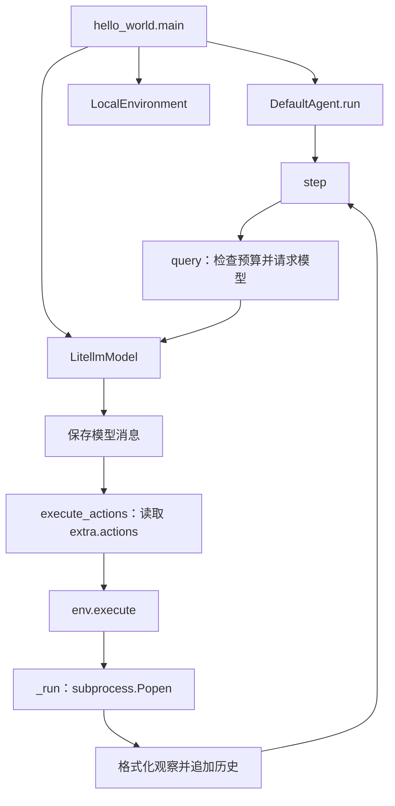
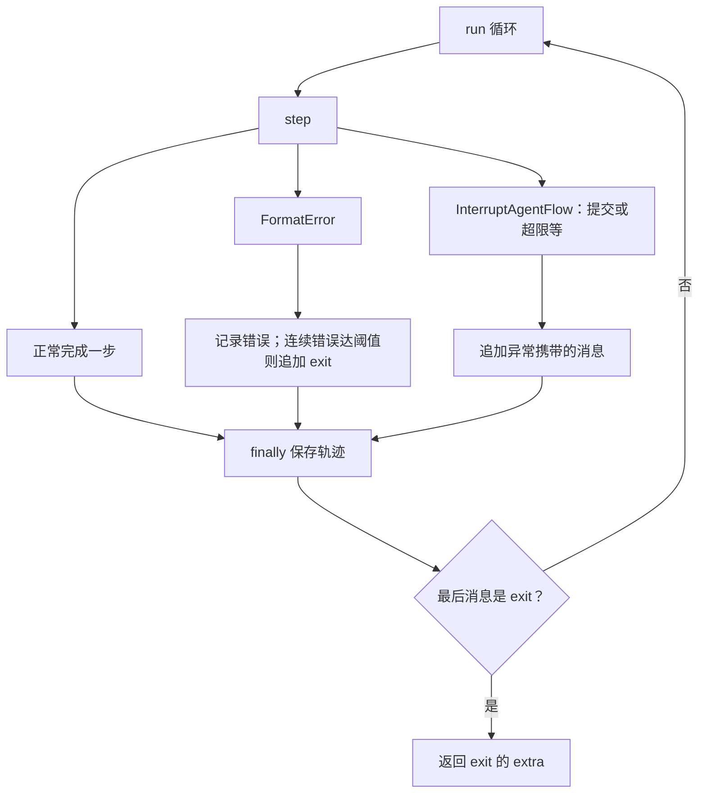

# 执行循环教学笔记

本文件为源码阅读解释，不是上游官方设计文档。图依据当前本地源码，未运行模型实验。

## 阅读顺序

1. [hello_world.main](../src/minisweagent/run/hello_world.py)：选择并组装模型、环境、Agent。
2. [DefaultAgent](../src/minisweagent/agents/default.py)：run → step → query → execute_actions。
3. [Model / Environment Protocol](../src/minisweagent/__init__.py)：理解组件接口。
4. [LocalEnvironment](../src/minisweagent/environments/local.py)：动作如何转为本地进程。
5. [控制流异常](../src/minisweagent/exceptions.py)：区分格式错误、提交和预算耗尽。

## 组件调用图

图中模型请求及格式化细节由 Model 实现负责；不是 SDK 自动执行函数。Environment 可替换，只要满足所需接口；LocalEnvironment 直接运行本机命令，不提供容器隔离。

## 控制流与退出

其他未处理异常会记录后重新抛出，也执行 finally。save 在未配置 output_path 时只序列化，不写文件。

LocalEnvironment 检查命令输出首行是否为 COMPLETE_TASK_AND_SUBMIT_FINAL_OUTPUT 且返回码为 0，据此抛出 Submitted；这表示提交信号，不证明任务通过外部测试。

query 在请求前检查步数、累计成本和总时间；单次请求可能使费用超过上限，总时间检查也不是硬中断。命令超时由环境单独处理。

## 与订单实验对照

| 订单实验 | mini 实现 |
| --- | --- |
| 请求封装 | Model.query |
| tool_calls | 内部 extra.actions（适配层负责转换） |
| 显式调用订单函数 | Environment.execute |
| tool 消息回传 | format_observation_messages + add_messages |
| max_rounds | step_limit、cost_limit、wall_time_limit_seconds |

## 学习问题

- 替换执行环境为什么通常不需要改 step？
- 格式错误为什么应反馈给模型，而不是一直原样重试？
- Submitted 与任务实际成功有什么区别？

## Codegraph

当前会话未提供可调用的 Codegraph 工具，未生成索引或安装相关依赖。上述图是依据源码人工整理；工具可用后可用于检索调用关系，再与实际代码交叉核对。
